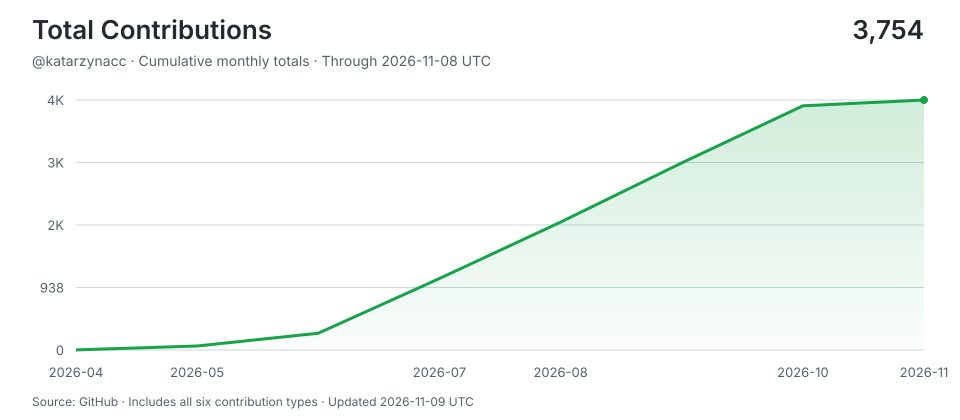

# Kasia CC

> Shipping with AI agents around the clock -- human hours for thinking, machine hours for doing.
>
> Stats auto-updated by [aidevops](https://aidevops.sh).

<!-- STATS-START -->
## Work with AI

| Metric | Yesterday | Prior 7 Days | Prior 28 Days | Prior 365 Days |
| --- | ---: | ---: | ---: | ---: |
| Screen time (Linux) | 24h | 167.9h | 481.4h | ~7269h* |
| Interactive human attention | 0.0h | 0.5h | 6.3h | 159.4h |
| Interactive AI generation | 0.0h | 0.3h | 4.8h | 316.2h |
| Worker-classified human attention | 0.0h | 0.0h | 16.2h | 65.0h |
| Worker/headless AI generation | 0.0h | 1.9h | 17.0h | 1387.0h |
| Additive observed work | 0.0h | 2.7h | 43.4h | 1,922.2h |
| Interactive sessions | 0 | 2 | 22 | 178 |
| Worker sessions | 86 | 156 | 1,151 | 16,336 |

_Screen time from linux-wtmp:login-session-proxy; collection status: ok. *365-day estimate uses observed calendar coverage._

_Periods are completed local calendar days ending at midnight; today is excluded._

_Human attention is unioned wall-clock time, so overlapping sessions are not double-counted. AI generation is additive machine work across sessions; it is not wall-clock concurrency._

_AI session 365-day totals cover 124 days of local assistant session history (not extrapolated)._

## AI Model Usage (last 30 days)

| Model | Requests | Input | Output | Cache read | Cache write | Cache Hit-Rate % | Session Count | Session Hours |
| --- | ---: | ---: | ---: | ---: | ---: | ---: | ---: | ---: |
| claude-sonnet-5-5 | 1,922 | 4K | 486K | 93.6M | 21.7M | 81.1% | 229 | 6.5h |
| claude-opus-4-6 | 1,642 | 1K | 348K | 134.1M | 6.0M | 95.7% | 158 | 9.2h |
| gpt-5.6-luna | 815 | 12.0M | 50K | 11.2M | 0 | 48.3% | 680 | 2.1h |
| nemotron-3-ultra-free | 608 | 15.5M | 67K | 62.1M | 0 | 80.0% | 5 | 3.2h |
| gpt-5.6-terra | 521 | 3.5M | 106K | 38.2M | 0 | 91.6% | 45 | 2.6h |
| big-pickle | 474 | 2.1M | 90K | 39.0M | 0 | 94.8% | 4 | 2.4h |
| gpt-5.6-sol | 358 | 1.4M | 45K | 24.7M | 0 | 94.3% | 48 | 1.8h |
| claude-sonnet-4-6 | 247 | 263 | 44K | 40.6M | 238K | 99.4% | 1 | 0.8h |
| gpt-5.6-sol-fast | 198 | 498K | 44K | 25.1M | 0 | 98.1% | 2 | 0.9h |
| gpt-6-luna-fast | 140 | 815K | 23K | 14.4M | 0 | 94.7% | 3 | 0.9h |
| claude-haiku-4-5 | 1 | 3 | 425 | 0 | 26K | 0.0% | 1 | 0.0h |
| gemini-3.6-flash | 1 | 0 | 0 | 0 | 0 | 0.0% | 1 | 0.0h |
| gpt-5.4 | 1 | 0 | 0 | 0 | 0 | 0.0% | 1 | 0.0h |
| gpt-5.4-fast | 1 | 0 | 0 | 0 | 0 | 0.0% | 1 | 0.0h |
| gpt-5.4-mini | 1 | 0 | 0 | 0 | 0 | 0.0% | 1 | 0.0h |
| gpt-5.5 | 1 | 0 | 0 | 0 | 0 | 0.0% | 1 | 0.0h |
| gpt-5.5-fast | 1 | 0 | 0 | 0 | 0 | 0.0% | 1 | 0.0h |
| **Total** | **6,932** | **36.0M** | **1.3M** | **483.5M** | **28.0M** | **88.3%** | **1,165** | **30.4h** |

_548.9M total tokens processed. 88.3% cache hit rate._

## AI Model Usage (all time)

| Model | Requests | Input | Output | Cache read | Cache write | Cache Hit-Rate % | Session Count | Session Hours |
| --- | ---: | ---: | ---: | ---: | ---: | ---: | ---: | ---: |
| claude-sonnet-4-6 | 207,006 | 222K | 69.2M | 20,493.2M | 605.7M | 97.1% | 5,012 | 1,141.1h |
| claude-opus-4-6 | 16,770 | 18K | 5.3M | 1,692.4M | 57.6M | 96.7% | 740 | 94.6h |
| deepseek-v4-flash-free | 15,088 | 36.8M | 3.1M | 1,278.4M | 0 | 97.2% | 199 | 47.7h |
| gpt-5.6-sol | 14,178 | 67.8M | 3.0M | 1,161.1M | 0 | 94.5% | 745 | 100.9h |
| claude-sonnet-4-5 | 10,580 | 52K | 2.9M | 499.3M | 33.2M | 93.8% | 339 | 35.9h |
| gpt-5.6-terra | 10,163 | 63.5M | 2.1M | 770.7M | 0 | 92.4% | 1,416 | 66.3h |
| gpt-5.6-luna | 6,860 | 78.6M | 401K | 79.8M | 0 | 50.4% | 6,068 | 25.3h |
| claude-haiku-4-5 | 4,893 | 20K | 960K | 275.1M | 8.8M | 96.9% | 138 | 18.8h |
| gpt-5.5 | 4,643 | 13.3M | 741K | 190.8M | 0 | 93.5% | 276 | 52.1h |
| gpt-5.4 | 4,187 | 15.8M | 1.0M | 239.4M | 0 | 93.8% | 202 | 31.3h |
| claude-sonnet-5-5 | 2,815 | 6K | 750K | 147.7M | 26.4M | 84.8% | 306 | 12.2h |
| gpt-5.6-sol-fast | 2,651 | 14.0M | 565K | 289.0M | 0 | 95.4% | 19 | 27.3h |
| x-preview-f-free | 1,238 | 5.5M | 296K | 172.5M | 0 | 96.9% | 7 | 12.3h |
| nemotron-3-ultra-free | 977 | 23.6M | 95K | 102.5M | 0 | 81.3% | 7 | 5.5h |
| gpt-5.4-mini | 747 | 1.8M | 108K | 37.2M | 0 | 95.2% | 28 | 3.9h |
| big-pickle | 474 | 2.1M | 90K | 39.0M | 0 | 94.8% | 4 | 2.4h |
| gpt-5.5-fast | 367 | 1.7M | 88K | 39.5M | 0 | 95.9% | 3 | 3.1h |
| claude-opus-4-8 | 357 | 708 | 367K | 69.8M | 5.5M | 92.6% | 1 | 3.6h |
| ling-3.0-flash-fin-free | 328 | 3.1M | 70K | 35.1M | 0 | 91.9% | 2 | 1.1h |
| gpt-6-luna-fast | 140 | 815K | 23K | 14.4M | 0 | 94.7% | 3 | 0.9h |
| north-mini-code-free | 28 | 915K | 284 | 0 | 0 | 0.0% | 2 | 0.0h |
| claude-sonnet-4 | 1 | 0 | 0 | 0 | 0 | 0.0% | 1 | 0.0h |
| gemini-3.6-flash | 1 | 0 | 0 | 0 | 0 | 0.0% | 1 | 0.0h |
| gpt-5.4-fast | 1 | 0 | 0 | 0 | 0 | 0.0% | 1 | 0.0h |
| gpt-6-astra | 1 | 7K | 505 | 0 | 0 | 0.0% | 1 | 0.0h |
| pool-account-management | 1 | 0 | 0 | 0 | 0 | 0.0% | 1 | 0.0h |
| **Total** | **304,495** | **330.0M** | **91.5M** | **27,627.8M** | **737.4M** | **96.3%** | **15,442** | **1,686.3h** |

_28,786.9M total tokens processed. 96.3% cache hit rate._
<!-- STATS-END -->

<!-- CONTRIBUTIONS-START -->
## Contributions

- **[aidevops](https://github.com/marcusquinn/aidevops)** -- Vibe-Coding is easy. DevOps is hard. OpenCode & Git token-efficient AI agent automation for your app, business, and personal development. Opinionated tools, services, CLI & API stack for speed, security, and 24/7 results. Open-source first. SOTA everything. Try on your repos for money-making magic.
<!-- CONTRIBUTIONS-END -->

## Connect

---

<!-- UPDATED-START -->
_Stats auto-updated 2026-11-03 09:11 UTC by [aidevops](https://aidevops.sh) pulse._
<!-- UPDATED-END -->

<!-- TOTAL-CONTRIBUTIONS-START -->

  <a href="https://commit-history.com/katarzynacc?metric=total" target="_blank" rel="noopener noreferrer">
    <picture>
      <source media="(prefers-color-scheme: dark)" srcset="assets/contributions/total-dark.svg" />
      
    </picture>
  </a>

[Verify on commit-history.com](https://commit-history.com/katarzynacc?metric=total) · [Chart data](assets/contributions/total.json)

Includes commits, issues, pull requests, reviews, repositories, and restricted contributions. Refreshed daily through the prior UTC day; commit-history.com may use a different refresh cutoff. GitHub controls link navigation—Ctrl/Cmd-click opens verification in a new tab.
<!-- TOTAL-CONTRIBUTIONS-END -->
