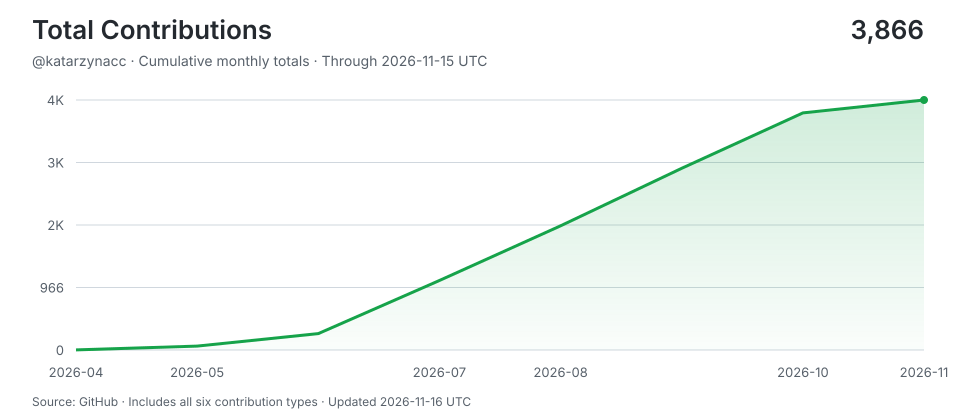

# Kasia CC

> Shipping with AI agents around the clock -- human hours for thinking, machine hours for doing.
>
> Stats auto-updated by [aidevops](https://aidevops.sh).

<!-- STATS-START -->
## Work with AI

| Metric | Yesterday | Prior 7 Days | Prior 28 Days | Prior 365 Days |
| --- | ---: | ---: | ---: | ---: |
| Input activity (Linux) | 1h | 8.7h | 9.1h | ~270h* |
| Interactive human attention | 0.0h | 6.0h | 6.9h | 165.7h |
| Interactive AI generation | 0.0h | 4.1h | 4.6h | 320.6h |
| Worker-classified human attention | 0.5h | 0.8h | 1.1h | 66.1h |
| Worker/headless AI generation | 1.9h | 25.3h | 32.6h | 1417.5h |
| Additive observed work | 2.4h | 36.1h | 45.2h | 1,964.5h |
| Interactive sessions | 1 | 8 | 11 | 187 |
| Worker sessions | 97 | 447 | 1,159 | 17,271 |

_Input activity from linux-input-activity:idle-cutoff-300s; collection status: ok. Input sampling began 2026-11-04 (12.3 of 28 days sampled); earlier days are not counted. Latest sample measured: desktop input. *365-day estimate uses observed calendar coverage._

_Periods are completed local calendar days ending at midnight; today is excluded._

_Human attention is unioned wall-clock time, so overlapping sessions are not double-counted. AI generation is additive machine work across sessions; it is not wall-clock concurrency._

_AI session 365-day totals cover 138 days of local assistant session history (not extrapolated)._

## AI Model Usage (last 30 days)

| Model | Requests | Input | Output | Cache read | Cache write | Cache Hit-Rate % | Session Count | Session Hours |
| --- | ---: | ---: | ---: | ---: | ---: | ---: | ---: | ---: |
| claude-sonnet-5-5 | 3,407 | 7K | 1.1M | 223.5M | 21.2M | 91.3% | 235 | 15.0h |
| gpt-5.6-terra | 2,033 | 11.1M | 430K | 161.4M | 0 | 93.5% | 151 | 11.8h |
| gpt-5.6-sol | 1,037 | 5.1M | 147K | 67.6M | 0 | 92.9% | 121 | 5.2h |
| claude-opus-4-6 | 557 | 733 | 117K | 43.8M | 2.5M | 94.5% | 85 | 2.5h |
| gpt-5.6-luna | 536 | 10.4M | 26K | 1.2M | 0 | 10.3% | 534 | 0.9h |
| claude-sonnet-4-6 | 359 | 470 | 82K | 36.7M | 2.0M | 94.6% | 6 | 2.3h |
| deepseek-v4.1-flash-free | 206 | 918K | 45K | 19.2M | 0 | 95.4% | 2 | 1.4h |
| gpt-6-luna-fast | 85 | 897K | 20K | 8.7M | 0 | 90.7% | 4 | 0.5h |
| claude-haiku-5-5 | 6 | 24 | 9K | 35K | 466K | 7.1% | 6 | 0.0h |
| gpt-6-sol | 1 | 0 | 0 | 0 | 0 | 0.0% | 1 | 0.0h |
| **Total** | **8,227** | **28.5M** | **1.9M** | **562.5M** | **26.3M** | **91.1%** | **1,137** | **39.7h** |

_619.4M total tokens processed. 91.1% cache hit rate._

## AI Model Usage (all time)

| Model | Requests | Input | Output | Cache read | Cache write | Cache Hit-Rate % | Session Count | Session Hours |
| --- | ---: | ---: | ---: | ---: | ---: | ---: | ---: | ---: |
| claude-sonnet-4-6 | 207,365 | 222K | 69.3M | 20,529.9M | 607.8M | 97.1% | 5,018 | 1,143.4h |
| claude-opus-4-6 | 17,257 | 18K | 5.4M | 1,735.9M | 59.3M | 96.7% | 755 | 96.9h |
| deepseek-v4-flash-free | 15,088 | 36.8M | 3.1M | 1,278.4M | 0 | 97.2% | 199 | 47.7h |
| gpt-5.6-sol | 14,869 | 71.6M | 3.1M | 1,204.7M | 0 | 94.4% | 820 | 104.3h |
| gpt-5.6-terra | 11,976 | 72.8M | 2.5M | 914.3M | 0 | 92.6% | 1,538 | 77.3h |
| claude-sonnet-4-5 | 10,580 | 52K | 2.9M | 499.3M | 33.2M | 93.8% | 339 | 35.9h |
| gpt-5.6-luna | 7,309 | 87.2M | 425K | 80.9M | 0 | 48.1% | 6,515 | 26.1h |
| claude-sonnet-5-5 | 6,204 | 13K | 1.8M | 371.2M | 47.2M | 88.7% | 523 | 27.2h |
| claude-haiku-4-5 | 4,893 | 20K | 960K | 275.1M | 8.8M | 96.9% | 138 | 18.8h |
| gpt-5.5 | 4,643 | 13.3M | 741K | 190.8M | 0 | 93.5% | 276 | 52.1h |
| gpt-5.4 | 4,187 | 15.8M | 1.0M | 239.4M | 0 | 93.8% | 202 | 31.3h |
| gpt-5.6-sol-fast | 2,651 | 14.0M | 565K | 289.0M | 0 | 95.4% | 19 | 27.3h |
| x-preview-f-free | 1,238 | 5.5M | 296K | 172.5M | 0 | 96.9% | 7 | 12.3h |
| nemotron-3-ultra-free | 977 | 23.6M | 95K | 102.5M | 0 | 81.3% | 7 | 5.5h |
| gpt-5.4-mini | 747 | 1.8M | 108K | 37.2M | 0 | 95.2% | 28 | 3.9h |
| big-pickle | 474 | 2.1M | 90K | 39.0M | 0 | 94.8% | 4 | 2.4h |
| gpt-5.5-fast | 367 | 1.7M | 88K | 39.5M | 0 | 95.9% | 3 | 3.1h |
| claude-opus-4-8 | 357 | 708 | 367K | 69.8M | 5.5M | 92.6% | 1 | 3.6h |
| ling-3.0-flash-fin-free | 328 | 3.1M | 70K | 35.1M | 0 | 91.9% | 2 | 1.1h |
| deepseek-v4.1-flash-free | 206 | 918K | 45K | 19.2M | 0 | 95.4% | 2 | 1.4h |
| gpt-6-luna-fast | 176 | 1.1M | 32K | 18.6M | 0 | 94.4% | 4 | 1.2h |
| north-mini-code-free | 28 | 915K | 284 | 0 | 0 | 0.0% | 2 | 0.0h |
| claude-haiku-5-5 | 6 | 24 | 9K | 35K | 466K | 7.1% | 6 | 0.0h |
| claude-sonnet-4 | 1 | 0 | 0 | 0 | 0 | 0.0% | 1 | 0.0h |
| gemini-3.6-flash | 1 | 0 | 0 | 0 | 0 | 0.0% | 1 | 0.0h |
| gpt-5.4-fast | 1 | 0 | 0 | 0 | 0 | 0.0% | 1 | 0.0h |
| gpt-6-astra | 1 | 7K | 505 | 0 | 0 | 0.0% | 1 | 0.0h |
| gpt-6-sol | 1 | 0 | 0 | 0 | 0 | 0.0% | 1 | 0.0h |
| pool-account-management | 1 | 0 | 0 | 0 | 0 | 0.0% | 1 | 0.0h |
| **Total** | **311,932** | **353.1M** | **93.4M** | **28,143.3M** | **762.4M** | **96.2%** | **16,325** | **1,722.8h** |

_29,352.4M total tokens processed. 96.2% cache hit rate._
<!-- STATS-END -->

<!-- CONTRIBUTIONS-START -->
## Contributions

- **[aidevops](https://github.com/marcusquinn/aidevops)** -- Vibe-Coding is easy. DevOps is hard. OpenCode & Git token-efficient AI agent automation for your app, business, and personal development. Opinionated tools, services, CLI & API stack for speed, security, and 24/7 results. Open-source first. SOTA everything. Try on your repos for money-making magic.
<!-- CONTRIBUTIONS-END -->

## Connect

---

<!-- UPDATED-START -->
_Stats auto-updated 2026-11-17 10:31 UTC by [aidevops](https://aidevops.sh) pulse._
<!-- UPDATED-END -->

<!-- TOTAL-CONTRIBUTIONS-START -->

  <a href="https://commit-history.com/katarzynacc?metric=total" target="_blank" rel="noopener noreferrer">
    <picture>
      <source media="(prefers-color-scheme: dark)" srcset="assets/contributions/total-dark.svg" />
      
    </picture>
  </a>

[Verify on commit-history.com](https://commit-history.com/katarzynacc?metric=total) · [Chart data](assets/contributions/total.json)

Includes commits, issues, pull requests, reviews, repositories, and restricted contributions. Refreshed daily through the prior UTC day; commit-history.com may use a different refresh cutoff. GitHub controls link navigation—Ctrl/Cmd-click opens verification in a new tab.
<!-- TOTAL-CONTRIBUTIONS-END -->
